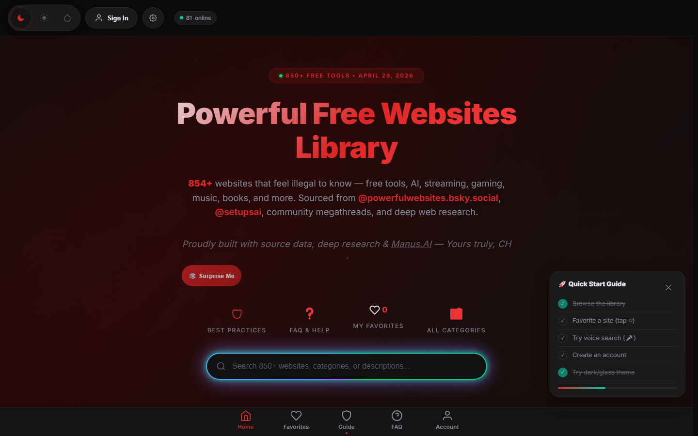

# Powerful Websites

A searchable, installable directory of useful websites and browser tools across AI, design, development, learning, privacy, files, money, entertainment and more. Every entry has a plain description, its real limits, and a direct link. Nothing is sponsored and nothing is ranked by payment.

**Live:** [www.ntkwebsites.com](https://www.ntkwebsites.com)

## What it does

- Full-catalog search with categories and quick search chips.
- **No login filter.** Every site is marked No login, Login optional, or Account required. One switch hides everything that makes you sign up first. Link to it with `/?login=none`.
- Limits shown on every card, not just in search results.
- Saved links stay in `localStorage`. No account, no sync, no tracking profile.
- Dark interface, phone layout with compact cards, reduced-motion mode, a Motion on/off control.
- Installable PWA with offline support.
- Three secondary pages on the same design system: in-browser site tools, an FAQ, and a safety guide for pop-ups, ad blocking and VPNs.

## October 2026 update

- Every URL in the catalog was fetched again. `catalog-audit.js` now also removes 14 sites that lost their domain, went offline, or redirect to ad pages, and moves 12 to their new addresses (NotebookLM, Flow, Flow Music, GitHub.dev, Zoom and others).
- `data-extra-15.js` adds 171 new sites, 139 of them usable with no login: Vectorpea, Vert, Jitsi Meet, Kagi FastGPT, Pollinations, IT Tools, Python Tutor, OpenResume, Internet Arcade, Radio Garden, Just the Recipe and more. Total is now 1,252 sites, 883 of them open without an account.
- The two catch-all shelves ("Free Tools", "Free, No Signups") were merged into their real topics.
- Superlative copy ("best", "insane", "stunning") was rewritten across 70 entries to say what the site does and what it costs you.
- The homepage dropped its sci-fi labels ("signals", "field transmission", cursor coordinates) in favour of plain words, fixed a leftover lime accent, made the results sheet opaque, and raised every label under 10px.
- The tools, FAQ and safety-guide pages were moved onto the directory's design system through `pages.css` and lost 142 emoji.
- Dead files were removed: the old account-era homepage backup, admin and onboarding pages, Firebase config, unused stylesheets, and a tracked `node_modules` folder.

## Previous audit (September 2026)

- 84 sites removed for shutting down, losing their domain, or being hijacked; 82 moved to new addresses.
- `access-map.js` records whether each site needs a login.
- `data-extra-14.js` added 90 free sites.
- Homepage shell cut from 406 KB to 106 KB.

## Adding sites

Add a new `data-extra-N.js` with one category per filing group (`group:` picks the shelf) and give every site `n`, `u`, `d`, `l`, `a` (open / optional / account) and `k` search keywords. Fetch each URL before you commit it. Load the file in `index.html` and `sw.js`.

## Tech

Static HTML, CSS and JavaScript. Service worker for offline use. Deployed on Vercel.
